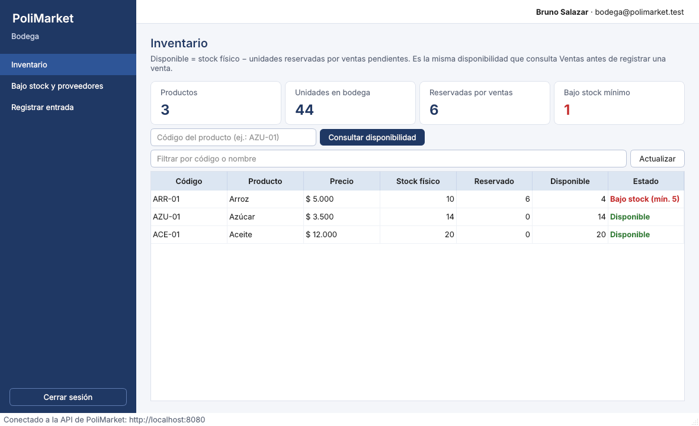

# Cliente de escritorio (C++ / Qt 6): Recursos Humanos y Bodega

Cliente de escritorio de PoliMarket para los usuarios de **Recursos Humanos** y **Bodega**. Solo habla con la
API HTTP de `../backend` (la `FachadaPoliMarket`), nunca con la base de datos.



## Pantallas y llamadas a la API

| Usuario | Pantalla | Llamadas |
|---|---|---|
| Ambos | Inicio de sesión | `POST /api/auth/login` → según `rol` abre RH o Bodega · `POST /api/auth/logout` |
| Recursos Humanos | Avales de vendedores | `GET /api/vendedores` → `POST /api/vendedores/{id}/aval/aprobar` o `/rechazar` |
| Recursos Humanos | Crear cuenta | `GET /api/terceros?tipoDocumento&numeroDocumento` → `POST /api/terceros` (si no existe) → `POST /api/usuarios` |
| Recursos Humanos | Cuentas | `GET /api/usuarios` → `POST /api/usuarios/{id}/desactivacion` |
| Recursos Humanos | Consultar autorización | `GET /api/vendedores` → `GET /api/vendedores/{id}/autorizacion` |
| Bodega | Inventario | `GET /api/productos` · `GET /api/inventario/bajo-stock` |
| Bodega | Bajo stock y proveedores | `GET /api/inventario/bajo-stock` · `GET /api/proveedores` |
| Bodega | Registrar entrada | `GET /api/proveedores` · `GET /api/productos` → `POST /api/inventario/entradas` (una por producto) |

Las cuentas `VENDEDOR` y `ENTREGAS` no entran a este cliente: el login les indica que usen el cliente web.
Capturas de todas las pantallas en [`docs/evidence/desktop-client`](../docs/evidence/desktop-client).

## Cómo cumple el contrato del backend

Según [docs/guides/clients.md](../docs/guides/clients.md), implementado en `src/servicios/rest/ApiCliente.cpp`:

1. **Sesión con cookie:** `QNetworkCookieJar` guarda y reenvía `JSESSIONID`.
2. **CSRF:** en cada `POST`/`PATCH` se copia la cookie `XSRF-TOKEN` al encabezado `X-XSRF-TOKEN`.
3. **JSON y errores:** se muestra el `mensaje` del error `{ "codigo", "mensaje" }` y se usa el `codigo` para decidir.
4. **Montos como texto:** `"5000.00"` se convierte solo para mostrar; `costoUnitario` se envía como texto.
5. **401 → login:** si la sesión expira o la cuenta se desactiva, la app vuelve al inicio de sesión con un aviso.

## Ejecutar

### 1. Encender el backend

Desde la raíz del repositorio (necesita Docker Desktop):

```bash
docker compose up --build
```

Cuentas de prueba (clave `Demo-1234`): `rh@polimarket.test` y `bodega@polimarket.test`.

### 2. Compilar el cliente

Requisitos: **CMake 3.16+**, compilador **C++17** y **Qt 6** con los módulos **Widgets** y **Network**.

**Windows (recomendado: Qt Creator)**
1. Instalar Qt 6 con el instalador en línea de Qt (cuenta gratuita), marcando el kit *MinGW 64-bit* y Qt Creator.
2. En Qt Creator: **Archivo → Abrir archivo o proyecto** → `desktop-client/CMakeLists.txt`.
3. Elegir el kit de Qt 6 y ejecutar con ▶.

**Línea de comandos (Windows, Linux o macOS)**
```bash
cd desktop-client
cmake -S . -B build -DCMAKE_PREFIX_PATH="<ruta a Qt>/6.x.x/<kit>"
cmake --build build --config Release
./build/polimarket_escritorio          # Windows: build\polimarket_escritorio.exe
```
En Ubuntu/Debian: `sudo apt install qt6-base-dev cmake g++`.
Para repartir el `.exe` en Windows: `windeployqt build\Release\polimarket_escritorio.exe`.

### Opciones

| Opción | Para qué |
|---|---|
| *(ninguna)* | Se conecta a `http://localhost:8080` |
| `--api=http://servidor:8080` o variable `POLIMARKET_API_URL` | Otro servidor |
| `--demo` o `POLIMARKET_MODO=demo` | Datos simulados, sin backend (para presentar sin Docker) |

La barra de estado de la ventana indica a qué se está conectado.

## Estructura

```
src/
├── main.cpp                     Arranque: crea los servicios y muestra el login
├── modelos/Modelos.h            DTO del backend y Respuesta<T> (ok, codigo, mensaje)
├── servicios/
│   ├── I*Service.h              Interfaces: lo único que conocen las pantallas
│   ├── ServiceFactory.*         Único lugar donde se elige REST o demostración
│   ├── rest/ApiCliente.*        HTTP con Qt Network: cookies, CSRF, JSON, 401
│   ├── rest/RestServicios.*     Implementación de las interfaces con la API
│   └── mock/MockServicios.*     Modo demostración con los datos de prueba del backend
└── ui/
    ├── LoginWindow, MainWindow  Inicio de sesión y menú según el rol
    ├── rh/                      Avales, crear cuenta, cuentas, autorización
    ├── bodega/                  Inventario, bajo stock, entradas
    └── comun/                   Estilos y utilidades
```

**Reutilización:** las pantallas dependen de las interfaces (`IRecursosHumanosService`, `IBodegaService`,
`IAutenticacionService`), no de las clases concretas. Por eso pasar de los datos simulados a la API real solo
cambió `ServiceFactory.cpp` y agregó `servicios/rest/`; las dos implementaciones conviven y se elige al arrancar.

## Pendiente (alcance de este cliente según la guía)

- Bodega: crear y modificar productos, registrar proveedores y asociarlos a productos, ajustes de inventario con motivo.
- Recursos Humanos: cambiar el correo de una cuenta (`PATCH /api/usuarios/{id}`).
